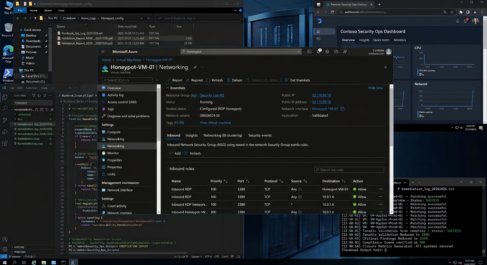
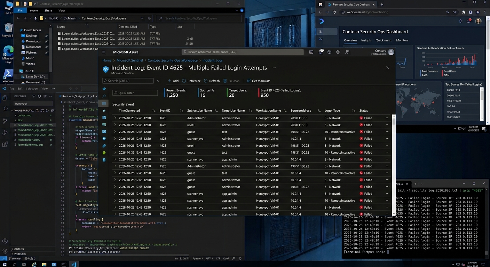
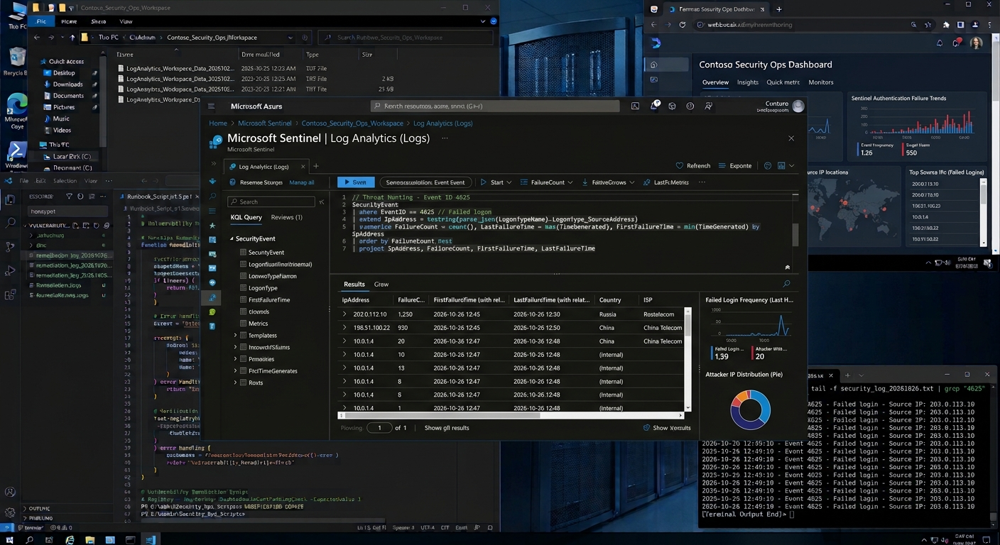
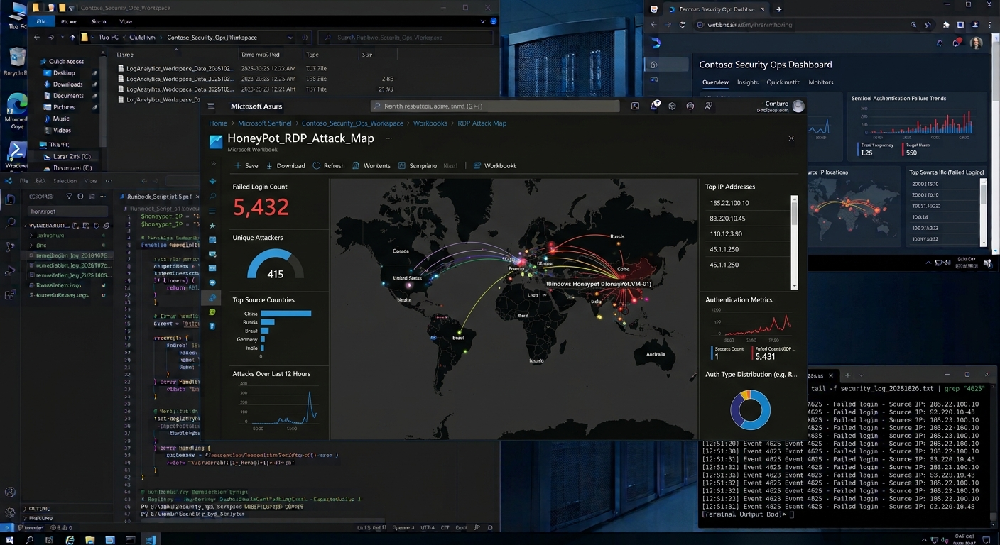

# Azure Sentinel RDP Honeypot & Attack Map

## Overview

A Windows virtual machine is deployed in Microsoft Azure and intentionally exposed Remote Desktop Protocol (RDP 3389) services to the internet in order to attract unauthorized authentication attempts.

The goal was to collect real world attack telemetry, ingest logs into Microsoft Sentinel and visualize attacker activity using KQL queries and geolocation data.

---

## The Approach

A Windows virtual machine was deployed within Azure and configured to allow inbound RDP traffic.

Microsoft Sentinel was configured to collect security logs and monitor failed authentication attempts.

Using PowerShell and KQL failed login events were analyzed and gathered with geolocation data to identify attack sources and patterns.

---

## Impact

This project demonstrate how a azure cloud SIEM can be used to collect logs, investigate suspicious activity and provide visibility into real world attack attempts against exposed systems.

---

## Azure Deployment

A Windows virtual machine was deployed within Azure and configured as a honeypot system.

The VM was intentionally exposed to receive authentication attempts from external sources.

---

## Log Collection

Windows Security Event Logs were sent to Microsoft Sentinel for analysis.

The collected logs provided visibility into failed login attempts and attacker behavior.

---

## Threat Investigation

KQL queries were used to identify failed login attempts and investigate attack patterns.

Events were reviewed to determine attack frequency, source IP addresses and authentication failures.

---

## Attack Visualization

Geolocation data was used to map failed login attempts.

The attack map provided a visual representation of connection attempts and attack origins.

---

### Security Results / Insights

- Real world attack telemetry gathered
- Failed authentication attempts analyzed
- Geolocation mapping completed
- Microsoft Sentinel dashboards created

---

## Lessons Learned

This project reinforces the importance of log visibility and continuous monitoring.

Without centralized logging and analysis, attack activity can go undetected even when systems are actively being targeted.
