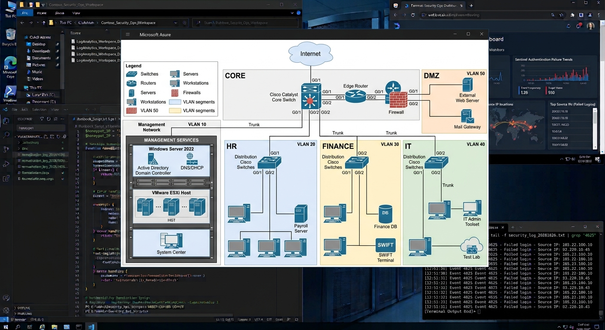
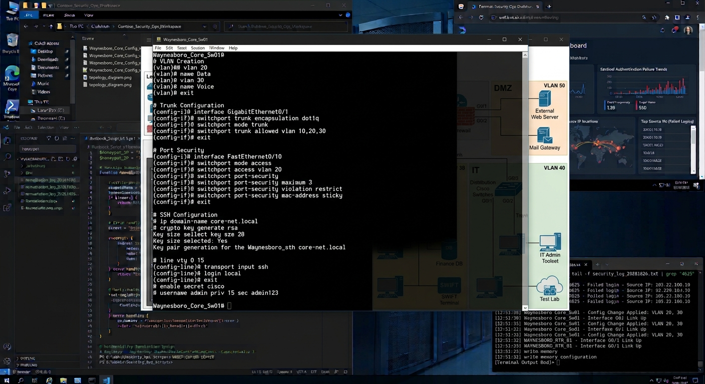
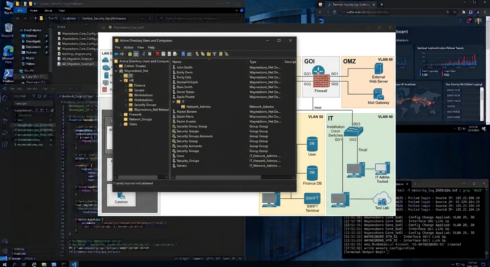
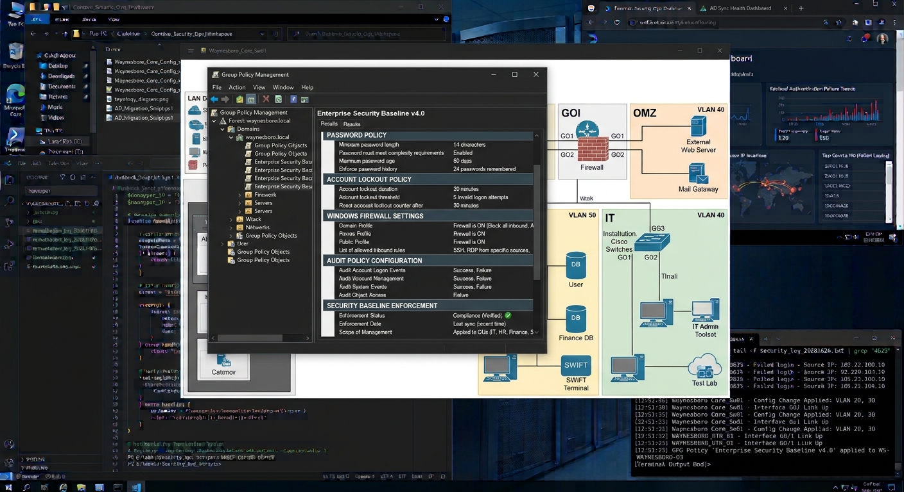

# Cisco IOS & Active Directory Hardening

## Overview

A Cisco-based network environment was configured with VLAN segmentation, port security and secure management protocols.

An Active Directory domain was deployed to centralize authentication and authorization. Organizational Units (OUs), Group Policy Objects (GPOs) and account security settings were used to establish baseline security controls.

---

## Impact

Layered security controls at both the network and identity level can help protect enterprise systems and reduce operational risk.

---

## Network Topology

A segmented network architecture was created using Cisco switches and VLANs to separate traffic and reduce exposure between systems.

This network design improves security, administrative control and visibility.

---

## Cisco Security Configuration

Cisco IOS was configured with best practices including port security, SSH and VLAN segmentation.

These controls help prevent unauthorized access and improve network resilience.

---

## Active Directory Structure

An Active Directory environment was configured to organize users, groups and devices using Organizational Units (OUs).

Administrative controls were applied using role based access.

---

## Group Policy Hardening

Group Policy was used to establish security baselines across the environment.

Policies were implemented to enforce password requirements, account lockout settings, firewall rules and system security.

---

## Results

### Security Improvements

- Network segmentation implemented
- SSH only access enabled
- Port security configured
- Active Directory centralized authentication configured
- Group Policy security baselines applied
- Administrative controls implemented

### Outcome

Improved security through layered controls in networking, identity management and endpoint hardening.

---

## Lessons Learned

Improves infrastructure by combining network controls with identity security.

Strong authentication with proper access controls, and secure network design work to reduce risk and support operational stability in enterprise environments.

## Repository Artifacts

### Active Directory Automation

[View AD User Creation Script](../scripts/ad-user-creation.ps1)

Demonstrates PowerShell-based Active Directory user creation and administrative automation.

