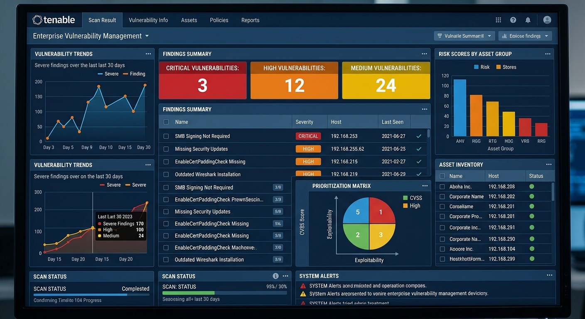
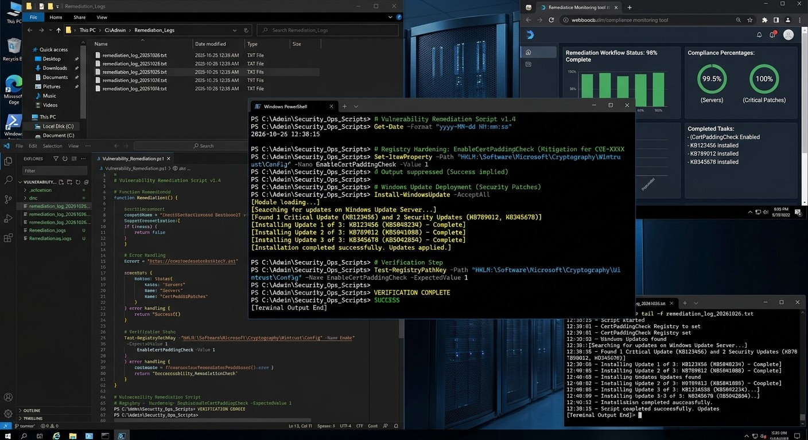
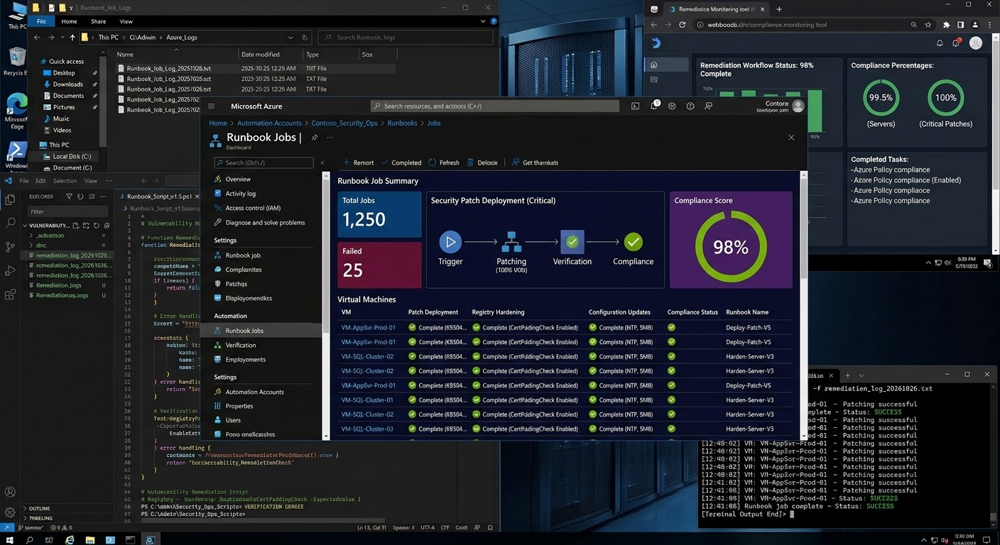

# Vulnerability Management & Remediation

## Overview

In this home lab project, an intentionally under-patched Windows Server in Azure simulates a vulnerable IT asset. My goal was to demonstrate the end to end process of identifying security gaps and applying systematic remediation.

## The Approach

Tenable Nessus is the scan the system, priority is based on the most critical vulnerabilities and then applied PowerShell scripts to implement patches and configuration changes.

## Impact

After remediation, a rescan is performed on the server to verify the security posture, which reduces the overall risk score and with established security benchmarks like those from CIS.

## Initial Vulnerability Scan

An authenticated vulnerability scan was performed using Tenable Nessus.

The scan identified multiple vulnerabilities including missing updates, insecure configurations and legacy protocols.

## PowerShell Remediation

PowerShell was used to automate remediation tasks and verify successful configuration changes.

Automated remediation improved consistency and reduced the manual administrative effort needed.

## Azure Automation & Compliance

Azure Automation Runbooks provide remediation workflows and monitor compliance status.

## Repository Artifacts

PowerShell Remediation Script:

`/scripts/powershell-remediation.ps1`
